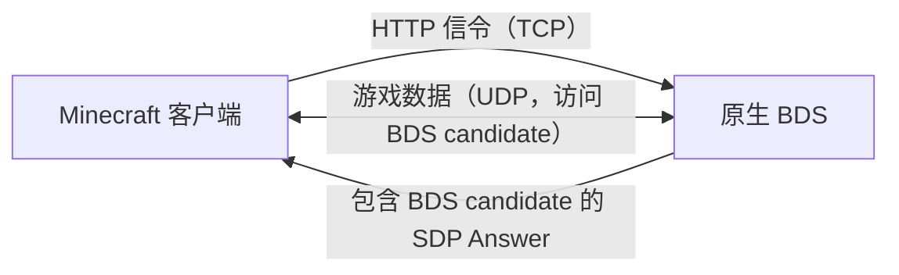
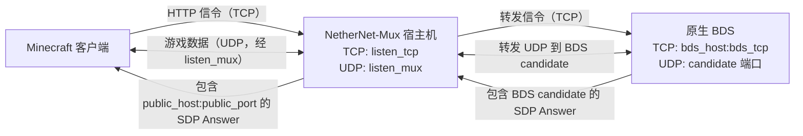
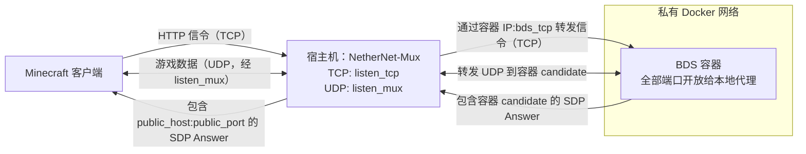

# NetherNet-Mux

> **使用责任：** 禁止将本项目用于任何违法犯罪行为。访问、下载或使用本项目，即视为已阅读
> 并同意遵守本声明。禁止未经授权或恶意利用本项目代理、转发流量至他人服务器，或造成经济及
> 其他损失；我们绝不容忍此类行为。如将本项目用于违法或恶意行为，作者及所有贡献者不承担由此
> 产生的责任，并保留依法追究相关责任的权利。由此造成的损失及相关法律责任，由过错方依法承担。

**语言 / Language：** [English](README.md) | 简体中文

NetherNet-Mux 是一个可配置的网络代理，用于管理多个 Minecraft 基岩版专用服务器
（BDS）的连接。程序使用 `nethernet-mux.json` 配置各个 BDS 实例及代理监听端口。

本文介绍如何获取和构建 NetherNet-Mux、配置 `nethernet-mux.json`，以及选择部署架构。

## 功能

- 使用一个配置文件管理多个 BDS 实例。
- 为每个 BDS 实例配置 TCP 监听端口。
- 为每个 BDS 实例配置 UDP 多路复用监听端口。
- BDS 地址支持 IPv4、IPv6 或域名。
- SDP candidate 对外地址支持 IPv4、IPv6 或域名。
- 启动前校验配置并检查代理监听端口冲突。

> **注意：** 本文描述当前配置模型。完整代理和转发功能是否可用，取决于所使用的发布版本。

## 安装方式

可以使用预编译版本，也可以从源码构建 NetherNet-Mux。

### 方式一：下载预编译版本

1. 打开 NetherNet-Mux 项目的 **Releases** 页面。
2. 下载与操作系统和 CPU 架构匹配的压缩包。
3. 解压文件。
4. 将 `nethernet-mux.json` 放在启动程序时的当前工作目录。
5. 按[配置方式](#配置方式)栏目配置文件。
6. 运行对应平台的可执行文件。

请使用与当前操作系统和 CPU 架构匹配的发布版本。

### 方式二：从源码构建

从源码构建需要兼容的 Rust 工具链和 Cargo。

1. 按照 [Rust 官方网站](https://www.rust-lang.org/tools/install) 的说明安装 Rust 和 Cargo。
2. 克隆或下载 NetherNet-Mux 源码。
3. 在项目目录打开终端。
4. 构建优化版本：

   ```bash
   cargo build --release
   ```

5. 可执行文件位于 `target/release/` 目录。

也可以通过 Cargo 直接运行：

```bash
cargo run --release
```

可执行文件的具体名称取决于操作系统。

## 配置方式

NetherNet-Mux 从程序的**当前工作目录**读取 `nethernet-mux.json`。请确保配置文件位于
启动程序时所在的目录。

### 首次启动

如果 `nethernet-mux.json` 不存在，程序会创建一个内容为空数组的文件：

```json
[]
```

随后程序会提示配置文件为空，需要填写配置。空文件也会被替换为空数组并提示配置。
启动前至少需要配置一个 BDS 实例。

### 配置结构

JSON 顶层必须是数组，数组中的每个对象代表一个 BDS 实例。

| 字段 | 类型 | 必填 | 说明 |
|---|---|---|---|
| `bds_type` | 字符串 | 是 | `bds_host` 的地址类型：`ipv4`、`ipv6` 或 `domain`。 |
| `bds_host` | 字符串 | 是 | BDS 信令服务的主机名或 IP，格式必须与 `bds_type` 匹配；不要包含端口。 |
| `bds_tcp` | 整数 | 是 | BDS 信令服务的 TCP 端口（`1`–`65535`）。 |
| `listen_tcp` | 整数 | 是 | NetherNet-Mux 为该实例监听信令请求的 TCP 端口（`1`–`65535`）。 |
| `listen_mux` | 整数 | 是 | NetherNet-Mux 为该实例监听游戏数据的 UDP 端口（`1`–`65535`）。 |
| `public_type` | 字符串 | 是 | `public_host` 的地址类型：`ipv4`、`ipv6` 或 `domain`。 |
| `public_host` | 字符串 | 是 | SDP Answer 中公布的公开地址，格式必须与 `public_type` 匹配；不要包含协议或端口。 |
| `public_port` | 整数 | 是 | SDP Answer 中公布的 UDP 端口（`1`–`65535`）。 |

所有端口字段必须是 JSON 整数，不能写成字符串。

### 地址类型

`bds_type` 和 `public_type` 支持以下值：

| 值 | 说明 |
|---|---|
| `ipv4` | 对应的主机字段必须是有效的 IPv4 地址。 |
| `ipv6` | 对应的主机字段必须是有效的 IPv6 地址。 |
| `domain` | 对应的主机字段必须是有效的域名。 |

`bds_type` 校验 `bds_host`，`public_type` 校验 `public_host`。两个设置互相独立，可以不同。

### IPv4 示例

```json
[
  {
    "bds_type": "ipv4",
    "bds_host": "192.168.1.10",
    "bds_tcp": 19132,
    "listen_tcp": 19301,
    "listen_mux": 19302,
    "public_type": "ipv4",
    "public_host": "203.0.113.10",
    "public_port": 19302
  }
]
```

### IPv6 示例

```json
[
  {
    "bds_type": "ipv6",
    "bds_host": "2001:db8::10",
    "bds_tcp": 19132,
    "listen_tcp": 19301,
    "listen_mux": 19302,
    "public_type": "ipv6",
    "public_host": "2001:db8::20",
    "public_port": 19302
  }
]
```

IPv6 地址不要加方括号，也不要附加端口。

### 域名示例

```json
[
  {
    "bds_type": "domain",
    "bds_host": "bds.internal.example",
    "bds_tcp": 19132,
    "listen_tcp": 19301,
    "listen_mux": 19302,
    "public_type": "domain",
    "public_host": "edge.example.com",
    "public_port": 19302
  }
]
```

### 配置多个 BDS 实例

在 JSON 数组中为每个 BDS 实例添加一个对象。每个实例必须使用独立的 `listen_tcp` 和
`listen_mux` 端口。

```json
[
  {
    "bds_type": "ipv4",
    "bds_host": "192.168.1.10",
    "bds_tcp": 19132,
    "listen_tcp": 19301,
    "listen_mux": 19302,
    "public_type": "domain",
    "public_host": "bds1.example.com",
    "public_port": 19302
  },
  {
    "bds_type": "ipv4",
    "bds_host": "192.168.1.11",
    "bds_tcp": 19132,
    "listen_tcp": 19303,
    "listen_mux": 19304,
    "public_type": "ipv4",
    "public_host": "203.0.113.10",
    "public_port": 19304
  }
]
```

第一个实例在代理上使用 TCP 端口 `19301` 和 UDP 端口 `19302`；第二个实例使用 TCP
端口 `19303` 和 UDP 端口 `19304`。示例中的 IP 和域名仅用于文档，请替换为实际地址。

### 配置校验

NetherNet-Mux 启动服务前会校验配置：

- 配置中至少要有一个 BDS 实例。
- `bds_host` 和 `public_host` 必须符合声明的地址类型。
- `bds_tcp`、`listen_tcp`、`listen_mux` 和 `public_port` 不能为 `0`。
- 所有代理监听端口不能冲突。
- 即使 TCP 和 UDP 使用不同传输协议，数值相同的监听端口也视为冲突。

域名校验允许每个标签使用 ASCII 字母、数字和连字符。标签不能为空、不能超过 63 字节，
且不能以连字符开头或结尾。域名可以有多个标签，也可以以点结尾；不带末尾点时最多
253 字节。这些检查不会验证域名是否存在、能否解析或网络是否可达。私有和回环 IP 不会
仅因为不是公网地址而被拒绝。

### 端口冲突说明

校验器会检查配置中所有代理监听端口：`listen_tcp` 不能重复，`listen_mux` 不能重复，
且两者的数值也不能相同，即使它们使用不同传输协议。

**重要：本机部署 BDS**

校验器不会检查 BDS 端口（例如 `bds_tcp`）是否与代理监听端口冲突。当 BDS 和
NetherNet-Mux 在同一台主机、同一个网络空间中运行时，请确保 BDS 服务端口没有与任何
代理监听端口冲突。

BDS 在单独的 Docker 网络空间运行时，其内部服务端口通常可以复用，不占用宿主机端口。
请确保 `bds_host` 和 `bds_tcp` 指向正确的 BDS 服务，且代理能够访问容器。

## 部署方式

| 方案 | 作用 | 优点 | 局限 |
|---|---|---|---|
| 原生 BDS，不使用代理 | 玩家直接连接 BDS。 | 架构最简单，没有代理进程或额外网络跳数。 | BDS 信令和所有 candidate 地址/端口都必须能被玩家访问；不能解决内网地址或 NAT 导致的不可达问题。 |
| 原生 BDS + NetherNet-Mux | BDS 和代理作为原生进程运行，可在同一主机或不同主机。 | 代理公布可达的 UDP 地址并转发流量；BDS 可以留在内网。 | 增加进程和网络跳数；代理必须能访问 BDS 所需端口，玩家必须能访问代理的公网 TCP/UDP 端口；同主机部署需避免监听端口冲突。 |
| Docker BDS + 宿主机 NetherNet-Mux | BDS 运行于私有 Docker 容器，代理运行于宿主机。 | BDS 端口隔离在容器网络空间。使用私有 Docker 网络、不使用 host 网络且不映射 BDS 端口时，BDS 不占用或冲突于宿主机端口；BDS 端口也不必暴露到公网。 | Docker 网络必须允许代理访问容器全部端口；容器 IP 改变后需更新代理配置；某些 Docker 平台默认不允许宿主机直接访问容器 IP。代理自身的 `listen_tcp` 和 `listen_mux` 端口仍必须在宿主机可用。 |

以下图示分别展示 TCP 信令和 UDP 游戏数据路径。代理部署中，`listen_tcp` 和
`listen_mux` 是代理监听端口，`public_host` 和 `public_port` 是写入 SDP Answer 并公布
给玩家的地址。

### 1. 原生 BDS，不使用 NetherNet-Mux

客户端直接连接 BDS 进行信令和游戏数据传输。BDS 在 SDP Answer 中公布的 candidate
地址必须能被客户端访问。该方案无法为位于 NAT 后面或私有网络中的 BDS 改写地址。



### 2. 原生 BDS 配合 NetherNet-Mux

BDS 和 NetherNet-Mux 以原生进程运行。两者可以在同一台或不同主机上，但代理必须能通过
TCP 和 UDP 访问 BDS。玩家只连接代理的公网端口。代理将信令转发给 BDS、登记 BDS UDP
candidate，并改写 Answer 中的 candidate；游戏 UDP 数据随后经代理转发。



防火墙必须允许玩家访问代理的 `listen_tcp` 和 `listen_mux`，并允许代理访问 BDS 的信令
端口和 candidate UDP 端口。

### 3. Docker BDS + 宿主机 NetherNet-Mux

这是推荐的 Docker 方案：BDS 运行在私有容器网络中，NetherNet-Mux 运行在宿主机（或其他
能够访问该网络的节点）。代理通过容器私网 IP 访问 BDS；玩家不会直接连接容器。



宿主机上的 NetherNet-Mux 必须能够通过容器 IP 访问 BDS。BDS 会动态选择 UDP candidate
端口：代理无法预先配置这个端口，BDS 也无法判断所选端口能否从代理侧访问。因此，
**BDS 容器的全部端口都必须开放给本地代理程序**。这些访问应限制在私有网络中，不要
将 BDS 容器端口暴露到公网。Docker 的 `EXPOSE` 设置本身不会发布端口或配置防火墙。

### 推荐的 Docker 部署方式

推荐只创建一个运行 BDS 的 Docker 容器，NetherNet-Mux 作为单独程序运行在宿主机。
BDS 留在私有 Docker 网络中，只有代理的公网入口需要接受玩家连接。

1. 创建 BDS Docker 容器并挂载持久化数据目录。将容器接入宿主机代理可访问的私有网络。
   使用容器网络而不是 host 网络，不要将 BDS 端口映射到宿主机，这样容器端口不会占用
   宿主机端口。
2. 进入容器，下载并安装官方 BDS 文件，或安装兼容的第三方发行版/加载器（例如
   LeviLamina），然后按其说明启动。第三方发行版可能已经提供 NetherNet 多路复用处理；
   请先确认其文档和兼容性，再决定是否需要额外的 mux。
3. 如果 `server.properties` 中存在 `server-udp-ports`，删除或注释该配置，不要把 BDS
   固定到单一 UDP 端口。BDS 应能为会话选择 UDP candidate 端口。
4. 在宿主机代理的 `nethernet-mux.json` 中，将 `bds_host` 设置为容器私网 IP，将
   `bds_tcp` 设置为 BDS 信令 TCP 端口。例如：

   ```json
   [
     {
       "bds_type": "ipv4",
       "bds_host": "172.20.0.2",
       "bds_tcp": 19132,
       "listen_tcp": 19301,
       "listen_mux": 19302,
       "public_type": "ipv4",
       "public_host": "203.0.113.10",
       "public_port": 19302
     }
   ]
   ```

   请将示例地址和端口替换为实际容器地址、BDS 端口、代理监听端口和公网地址。如果
   防火墙或 NAT 将不同的公网 UDP 端口映射到 `listen_mux`，请将 `public_port` 设置为
   公网 UDP 端口。
5. 允许本地代理通过私有 Docker 网络访问 **BDS 容器的全部端口**。这表示代理可访问
   容器端口，不表示需要将所有容器端口发布到公网。Docker 的 `EXPOSE` 设置本身不会发布
   端口或配置防火墙。
6. 先在容器内启动 BDS，再启动宿主机上的 NetherNet-Mux。确保玩家能访问代理的
   `listen_tcp` 和 `listen_mux`；必要时将公网端口转发到代理监听端口。

BDS 会在 SDP Answer 中包含所选 UDP 地址和端口。NetherNet-Mux 从 Answer 中读取
candidate 并转发游戏流量，因此代理不需要预先知道动态 UDP 端口。若重建容器后 IP
发生变化，请更新代理配置中的 `bds_host`。如果所用 Docker 平台不支持宿主机直接访问
容器 IP，请先配置可让代理访问容器端口的私有网络路径。

## 运行和停止

从包含 `nethernet-mux.json` 的目录启动程序。

程序将 `Ctrl+C` 作为关闭请求；Unix 系统也处理 `SIGTERM`。

如果启动失败，程序会打印错误信息。Windows 下会等待回车，方便双击启动时查看错误。

## 故障排除

**程序提示配置为空**

打开 `nethernet-mux.json` 并至少添加一个 BDS 实例。确认顶层内容是 JSON 数组。

**JSON 文件无法解析**

检查逗号、引号、大括号和字段类型。端口必须是整数，`bds_type` 和 `public_type` 必须
分别为 `ipv4`、`ipv6` 或 `domain`。

**主机地址与类型不匹配**

确认 `bds_type` 与 `bds_host`、`public_type` 与 `public_host` 相匹配。例如 IPv6 地址
应使用 `ipv6`，域名应使用 `domain`。

**监听端口已被占用**

所有实例的 `listen_tcp` 和 `listen_mux` 必须互不重复。请为冲突项选择不同端口。如果
BDS 部署在本机，也要检查 BDS 服务端口是否与代理监听端口冲突。

**域名通过校验但无法连接**

配置校验只检查域名语法。请另外检查 DNS 记录、运行 NetherNet-Mux 的主机能否解析域名，
以及网络是否可达。

## 许可证

NetherNet-Mux 使用 MIT License。完整许可证文本请参阅仓库中的
[`LICENSE`](LICENSE) 文件。
